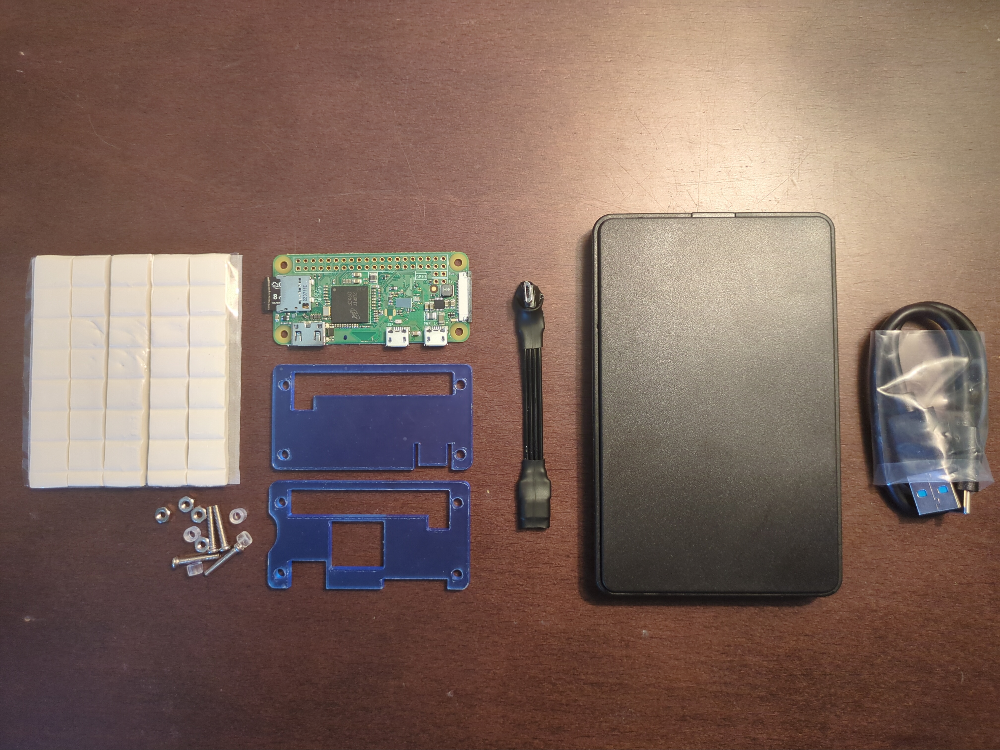
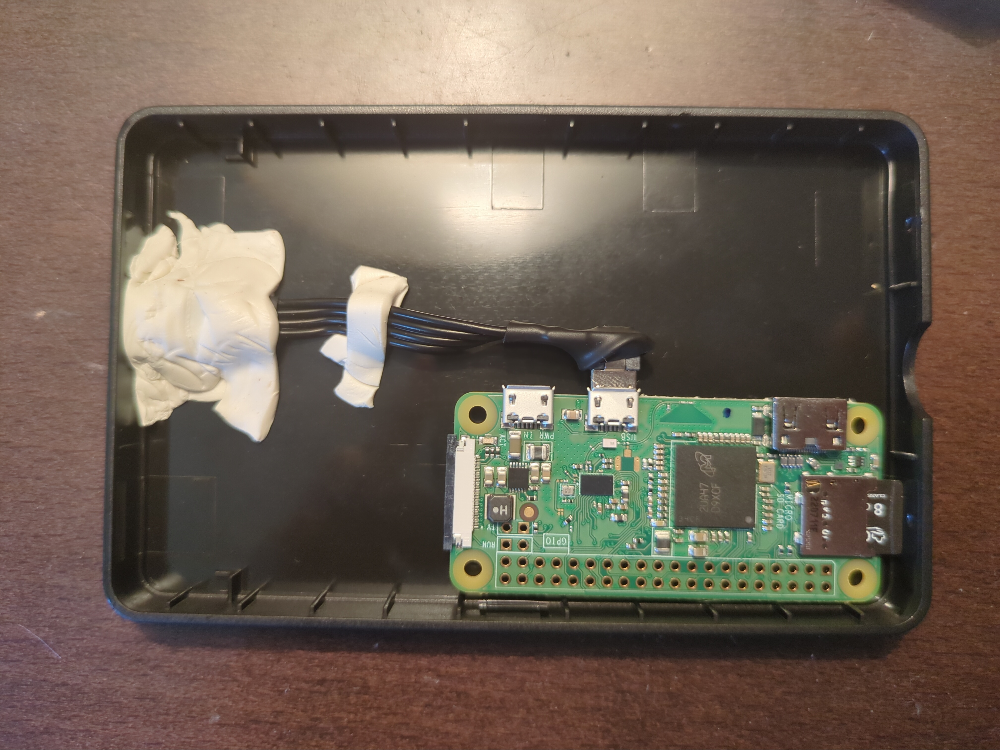
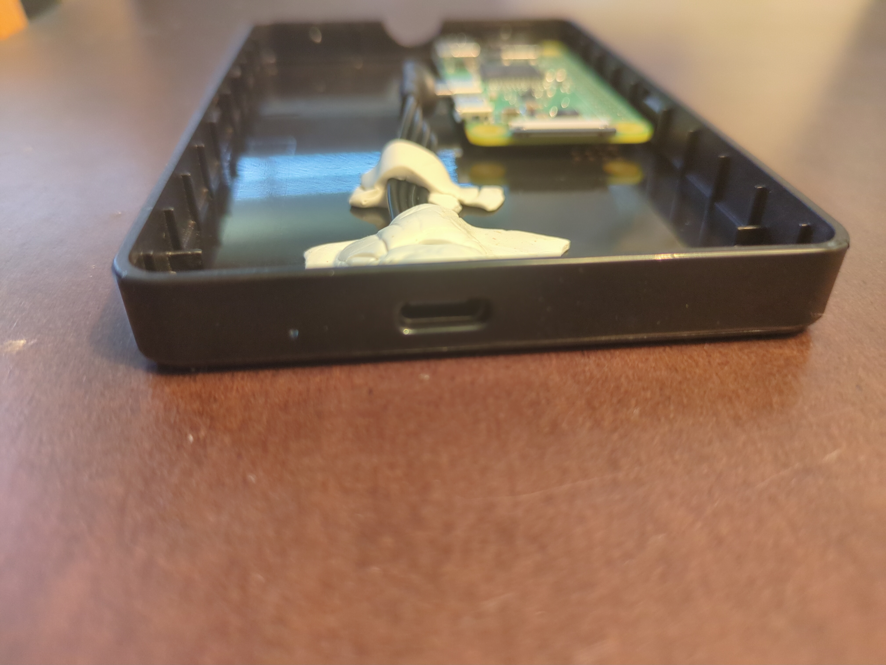
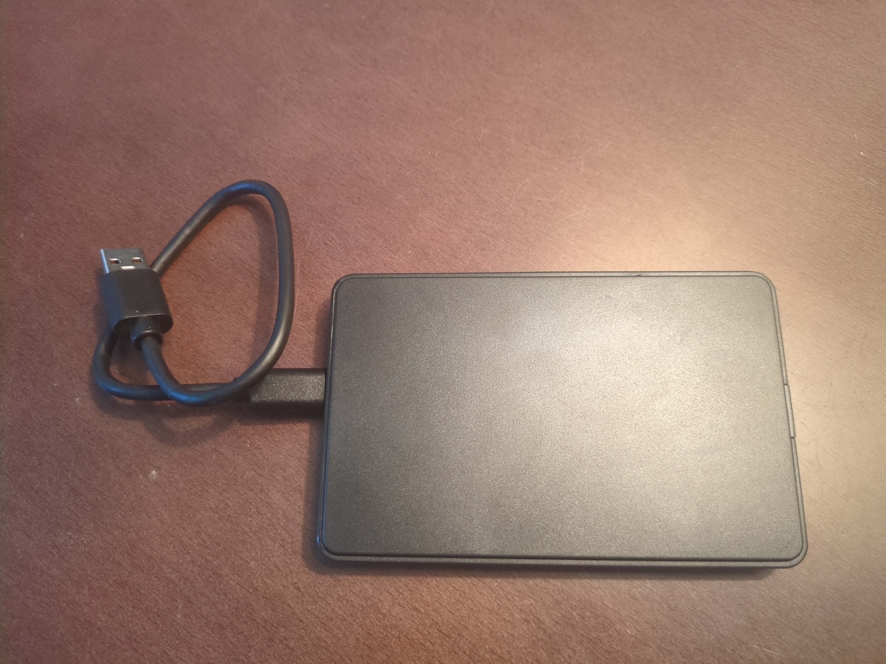

## "Bad External SSD"

I've seen some clever builds for this type of Bad-USB device with the Pi zero. One that I find interesting is hiding it inside a mouse. If you match the model that the target company uses it could go unnoticed while plugged. 

But the idea I had from the beginning was making it a "Bad External SSD", so I bought a cheap case and some data cables for it.

### Components

- SSD plastic case (Easy to open and close. Came with cable)
- Short microUSB male <=> USB-C female data cable
- Adhesive paste
- Raspberry Pi zero W
- Raspberry Pi zero "case"

Ended up not using the Pi case (2 blue pieces and screws/knobs...)

### Mounting

I simply stick the Pi to the base of the SSD case with some adhesive paste. Connect the short flexible cable to the PI DATA port and align it with the USB-C hole on the SSD case with a good amount of adhesive paste, so plugging the USB cable from the outside doesnt lose the short cable and also gives it a bit more weight so it doesnt feel off when holding it.

Make sure its well aligned and the cable can be fully connected.

Place the lid on top and thats pretty much it.

### PROS

1. Disguised. People know this type of devices. Its just a external storage.
2. Mysterious, USB Drop potential. Imagine you (hypothetically someone that is not aware of the existence of such malicious devices) find this on your office/home desktop table. You recognize is a storage device. You have a computer available. Would you not plug it to see whats inside?
3. Cheap, very easy to make. The case and cables cost ~ 5 EUR. Can be assembled in few minutes.
4. Covered. Somewhat prevents dust and water. 

### CONS

1. Bigger size. Bulkier than just the Raspberry Pi zero W on its own.
2. No brand / Cheap build. Someone used to real external drives will probably notice something is off (quality, weight, missing brand/stickers). Once opened there is no doubt is not a external drive and furthermore there is a significant chance its intended use is discovered.

### Conclusion

This device appearance can be used in favor for a USB drop attack, whether it works or its detected depends on the context and environment. Can be also used normally, controlled by the attacker, quick plug and go, but for that specific task where being disguised is almost trivial, a standalone Pi zero W or a USB STICK build is a better choice.
